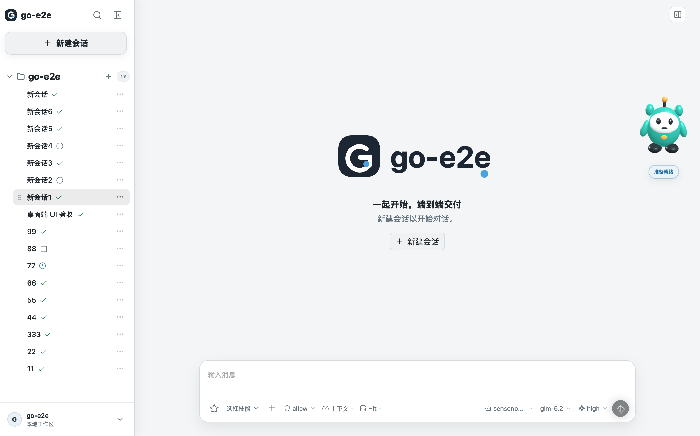

+++
title = "go-e2e"
date = 2026-10-13T00:00:00+08:00
description = "用 Go 构建的本地优先开源 AI Coding Agent，支持 Desktop、CLI、TUI、WebUI、MCP、Skills、多智能体协作与多模型 Provider。"
summary = "用 Go 构建的本地优先 AI Coding Agent：从任务理解、规划、工具调用到代码修改、命令执行和结果验证，形成完整的任务交付闭环。"
project_summary = "本地优先的 AI Coding Agent 工作台，让自然语言任务真正走完理解、执行与验证。"
project_language = "Go"
docs_label = "5 分钟上手"
project_status = "持续迭代"
project_order = 1
featured = true
project_kicker = "Go · AI Coding Agent · Local-first"
project_tagline = "一句话输入，持续执行，结果验证，自主可控。"
seo_title = "go-e2e：本地优先的 AI Coding Agent | KongLong"
lastmod = 2026-10-14T00:00:00+08:00
project_audience = "想在本地运行、调试并验证 AI Coding Agent 的开发者。"
project_boundary = "项目仍在持续迭代，具体平台、模型和发布能力以仓库当前说明为准。"
repo_url = "https://github.com/konglong87/go-e2e"
release_url = "https://github.com/konglong87/go-e2e/releases/latest"
docs_url = "https://github.com/konglong87/go-e2e/blob/main/docs/getting-started.md"
tags = ["项目", "Go", "AI Coding Agent", "MCP", "Skills"]
+++




*图片来自项目仓库的真实 Desktop 工作台截图。*

## 它要解决什么问题？

go-e2e 是一个本地优先的开源 Coding Agent 工作台。它不是只返回一段聊天文本的助手，而是围绕“任务执行和结果交付”设计的 Agent runtime：理解项目、规划步骤、调用工具、修改代码、执行命令，并把验证结果交付回来。

我希望它能够把一次开发任务从“告诉 AI 我想做什么”，推进到“任务真的完成了，而且结果经过了验证”。

## 适合哪些场景？

- **日常开发**：分析仓库、实现功能、修复 Bug、运行测试并总结变更。
- **终端自动化**：通过 CLI / TUI 执行一次性任务、持续会话和脚本化工作流。
- **本地优先工作台**：在自己的电脑或私有环境中保存会话、配置模型和管理权限。
- **Agent 二次开发**：通过 Provider、Skills、MCP、Tools、Profile 和 Web/API 扩展能力。
- **团队与渠道协作**：使用 WebUI、MySQL、飞书渠道和多 Agent 能力组织长期任务。

## 核心设计

### 一套 Runtime Core，多种入口

Desktop、CLI、TUI、WebUI 和飞书渠道共享同一套核心运行时。入口可以变化，但任务理解、工具调用、会话管理和结果验证不需要重复实现。

这让 go-e2e 既可以作为一个桌面应用使用，也可以接入脚本、Web 服务或团队协作渠道。

### 从需求到验证形成闭环

一个完整任务大致经过：

```text
自然语言任务
    ↓
理解项目与任务边界
    ↓
规划执行步骤
    ↓
调用工具、修改代码、执行命令
    ↓
检查结果与测试证据
    ↓
向用户报告交付结果
```

重点不只是“生成代码”，而是让执行过程、工具结果和最终验证都成为任务的一部分。

### 能力按边界扩展

Provider、Skills、MCP、Tools、Profile、权限和工作流都有明确的扩展边界。这样新增模型、新工具或新工作流时，不需要把所有能力揉进一个巨大的 Agent 函数里。

### 本地优先，同时保留部署空间

默认可以使用 SQLite 在本机运行，也支持私有化部署和 MySQL。开发者可以先从单机桌面端开始，再根据团队需要扩展到 WebUI、服务端或协作渠道。

## 30 秒快速开始

### 下载桌面端

从 [GitHub Releases](https://github.com/konglong87/go-e2e/releases/latest) 下载对应平台的安装包。打开应用后，在设置中填写模型 Provider、API 协议、模型、地址和凭据，然后输入第一条任务。

### 从源码运行 CLI

```bash
git clone https://github.com/konglong87/go-e2e.git
cd go-e2e
go run ./cmd/go-e2e --version
go run ./cmd/go-e2e -p "检查当前项目结构，告诉我最值得先改进的地方"
```

最低源码要求为 Go 1.25+。配置文件默认位于 `~/.golang-cc/settings.json`，完整安装、配置和排障路径见 [5 分钟上手](https://github.com/konglong87/go-e2e/blob/main/docs/getting-started.md)。

## 使用前需要了解

“本地优先”不等于所有模型计算都在本机完成。使用云端 Provider 时，模型请求仍会发送到你配置的服务端；模型凭据、服务费用和代码数据边界需要自己确认。首次体验建议选择范围小、可验证的任务，并检查 Agent 的实际工具结果与测试证据。

## 为什么把它作为精选项目？

go-e2e 是我对“AI 不只是回答问题，而是要把事情做完”的一次持续实践。它同时覆盖了本地应用、Agent runtime、工具调用、模型 Provider、Skills、MCP、多入口交互和结果验证，是目前我最希望持续打磨的一条主线。

## 项目链接

- [GitHub 仓库](https://github.com/konglong87/go-e2e)
- [最新版本下载](https://github.com/konglong87/go-e2e/releases/latest)
- [5 分钟上手](https://github.com/konglong87/go-e2e/blob/main/docs/getting-started.md)
- [使用场景](https://github.com/konglong87/go-e2e/blob/main/docs/use-cases.md)
