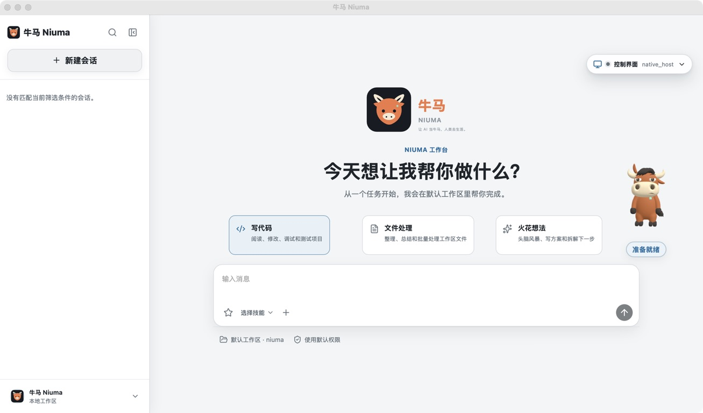

+++
title = "牛马 Niuma"
date = 2026-10-27T00:00:00+08:00
description = "牛马 Niuma 是本地优先的开源 AI 执行工作台，通过后台任务、周期调度、会话恢复和检查点推进长期工作，并保留权限、预算与停止边界。"
summary = "把目标交给牛马，让 AI 在边界内推进工作：理解项目、拆解任务、修改文件、运行验证，遇到阻塞再清楚交接。支持桌面端、CLI、TUI、WebUI 和工具扩展。"
project_summary = "让 AI 当牛马，人类去生活。用后台任务、调度与检查点推进长期工作。"
project_language = "Go"
project_status = "持续迭代"
project_order = 9
featured = true
project_kicker = "Go · Long-running Agent · Local-first"
project_tagline = "让 AI 当牛马，人类去生活。"
seo_title = "牛马 Niuma：能持续推进长期任务的开源 AI Agent | KongLong"
lastmod = 2026-10-27T00:00:00+08:00
project_audience = "希望在自己的设备上组织长任务、周期工作和代码开发，并能查看执行证据的开发者。"
project_boundary = "后台运行不等于无限运行或保证成功；任务受设备、网络、模型服务、预算和权限约束，遇到阻塞需要暂停并交接。"
repo_url = "https://github.com/konglong87/niuma"
release_url = "https://github.com/konglong87/niuma/releases/latest"
docs_url = "https://github.com/konglong87/niuma/blob/main/docs/getting-started.md"
docs_label = "5 分钟上手"
tags = ["项目", "Go", "AI Coding Agent", "MCP", "Skills", "工作流"]
+++



*图片来自项目公开仓库的真实桌面工作区截图，不是概念图。*

## 为什么做牛马？

很多 AI 工具擅长回答问题，但当工作需要持续推进、跨多轮执行或中断后继续时，用户仍要反复盯着屏幕，检查进度、补充上下文和确认结果。

牛马 Niuma 想解决的是这类“需要把事情做下去”的任务。它是一个本地优先的开源 AI 执行工作台，可以理解项目、规划步骤、调用工具、修改文件、运行命令和测试；通过后台任务、周期调度、会话恢复与检查点，把一次对话延伸成可以检查进展的工作过程。

它的口号是：**让 AI 当牛马，人类去生活。** 这不是承诺 AI 永不停止，而是尽量减少不必要的守候，同时把关键决定留给人。

## 适合交给它的工作

| 场景 | 让牛马做什么 | 自己检查什么 |
| --- | --- | --- |
| 理解陌生代码库 | 梳理目录、运行入口、关键模块与测试入口 | 文件引用与调用链是否准确 |
| 修复 Bug、实现功能 | 复现问题、拆解步骤、修改代码并补测试 | 改动范围、回归命令与测试结果 |
| 长期任务 | 使用后台 Goal、会话恢复和 Checkpoint 推进多轮工作 | 已完成步骤、当前状态与阻塞原因 |
| 周期工作 | 通过 Loop 与本地调度器安排重复任务 | 下次触发时间、运行历史与日志 |
| 扩展工作流 | 接入 Skills、MCP、Workflow 或多 Agent 分工 | 调用权限、工具输出与汇总证据 |

第一次体验建议从范围明确的小任务开始，而不是直接把重要目录和无限制权限全部交出去。

## 核心设计：持续推进，但不越过边界

### 一套核心，多种入口

Desktop、CLI、TUI、WebUI、API、MCP 与飞书渠道共用运行时核心。日常可以使用桌面工作区，终端任务可以选择 CLI / TUI，需要外部工具时再接入扩展能力，而不必为每种入口重复搭建执行逻辑。

### 任务状态可检查，中断之后有路可回

后台 Goal 和周期调度让工作不局限于一次即时回复；会话恢复、Checkpoint 和 Rewind 则提供回看与继续任务的入口。

```text
交代目标、范围和验收条件
    ↓
理解项目、规划步骤
    ↓
调用工具并推进工作
    ↓
检查日志、状态与验证结果
    ↓
完成后交付证据；遇到阻塞暂停并交接
```

这里的重点不是“模型说已经完成”，而是能看到它实际检查了哪些文件、执行了什么命令，以及还有哪些未完成项。

### 本地优先不等于完全离线

项目默认使用 SQLite，也支持面向团队部署的 MySQL。模型 Provider、MCP Server 和飞书等外部服务需要单独配置。

如果选择云端模型，相关请求仍会发送到配置的模型服务。本地优先描述的是运行与数据管理方式，不代表模型计算全部发生在本机。使用前需要确认代码和任务数据的发送边界，不要把 API Key 提交到仓库。

权限审批、路径边界、预算和停止控制依然由使用者掌握。设备休眠、网络异常、模型服务不可用、预算耗尽或等待授权，都可能使任务暂停；周期调度也不等于设备离线后仍能自动执行。

## 快速开始

### 桌面版

前往 [GitHub Releases](https://github.com/konglong87/niuma/releases/latest)，选择对应平台的桌面安装包。打开设置，配置模型服务、API 地址、模型与凭据，再提交一条有明确验收条件的任务。

安装方式、平台支持和签名状态，以对应版本的 Release Notes 为准。

### 源码运行 CLI

源码最低要求是 **Go 1.26+**：

```bash
git clone https://github.com/konglong87/niuma.git
cd niuma
go run ./cmd/niuma --version
go run ./cmd/niuma -p "检查当前项目结构，指出一个问题并运行对应验证"
```

用户配置默认位于：

```text
~/.niuma/settings.json
```

具体 Provider 字段、协议与排障方法，见 [5 分钟上手](https://github.com/konglong87/niuma/blob/main/docs/getting-started.md)。模型凭据由自己配置，服务费用取决于所选 Provider。

### 第一条任务怎么写？

可以先从不修改文件的任务开始：

```text
分析当前仓库的 README、目录结构与测试入口，不要修改文件。
最后列出：关键模块、实际阅读过的文件路径、三条改进建议，以及无法确认的信息。
```

后续需要修改代码时，再明确允许修改的目录、不能改变的接口、必须执行的测试和最终交付内容。任务完成后，检查实际差异与测试证据，而不只看一句“已完成”。

## 不只有执行，还有桌面伙伴

牛马也保留了更轻松的桌面体验。在 **设置 → 宠物** 中可以启用桌面伙伴，选择牛马形象、Go 伙伴或中国龙；支持待机、专注和庆祝动画，以及拖动、缩放和隐藏。

这层个性化不替代任务状态与日志。界面可以有性格，执行结果仍然需要证据。

## 和 go-e2e 是什么关系？

Niuma 基于 [go-e2e](/projects/go-e2e/) 的一个源码快照建立，是独立项目，并采用 Apache-2.0 许可；具体来源记录见 [UPSTREAM.md](https://github.com/konglong87/niuma/blob/main/UPSTREAM.md)。

它使用独立的 `niuma` 身份与默认目录，配置、任务状态、会话、记忆和调度数据**不会复用**原 go-e2e 的应用数据目录。本博客分别保留两个项目介绍，便于了解各自的定位；不要把它当作自动迁移原有配置的替换安装包。

## 继续了解

- [GitHub 源码与项目说明](https://github.com/konglong87/niuma)
- [下载桌面版](https://github.com/konglong87/niuma/releases/latest)
- [5 分钟上手](https://github.com/konglong87/niuma/blob/main/docs/getting-started.md)
- [使用场景与任务写法](https://github.com/konglong87/niuma/blob/main/docs/use-cases.md)
- [安全与权限说明](https://github.com/konglong87/niuma/blob/main/SECURITY.md)

*本文根据 2026-10-27 的公开 README、上手文档与使用场景整理。功能、平台和安装要求可能随版本变化，请以仓库当前说明为准。*
